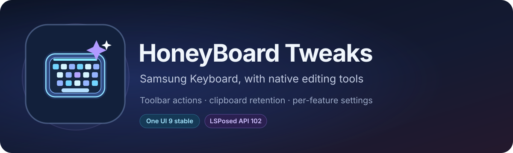

<p align="center">
  
</p>

<p align="center">
  <a href="https://github.com/igorcv88/HoneyBoard-Tweaks/releases/latest"></a>
  <a href="https://github.com/igorcv88/HoneyBoard-Tweaks/releases"></a>
  <a href="https://github.com/igorcv88/HoneyBoard-Tweaks/actions/workflows/release.yml"></a>
  
  
  
  <a href="LICENSE"></a>
</p>

<p align="center"><strong>A focused LSPosed module for Samsung Keyboard's native editing toolbar and clipboard retention.</strong></p>

<p align="center">
  <a href="https://github.com/igorcv88/HoneyBoard-Tweaks/releases/latest">Latest APK</a> ·
  <a href="docs/DZIF-hooks.md">Hook mapping</a> ·
  <a href="docs/runtime-diagnostics.md">Runtime diagnostics</a> ·
  <a href="docs/device-validation.md">Test plan</a>
</p>

## About

HoneyBoard Tweaks adds configurable editing actions to the Samsung Keyboard toolbar, changes the native clipboard's retention policy, and exposes selected hidden keyboard settings. The module hooks **Samsung Keyboard only** (`com.samsung.android.honeyboard`); it does not replace the keyboard, patch its APK, or migrate its database.

The toolbar uses Samsung's own Bee/toolbar UI, so its items participate in the keyboard's layout, ordering, and overflow. The app's settings control individual features.

## Features

**Native editing actions.** Select All, Copy, Undo and Redo have individual toolbar buttons enabled by default. Cut and Paste are optional. Buttons can be rearranged in the Samsung toolbar editor. Select All and Copy have been observed working on-device; the newer Undo/Redo route requires further testing across editors.

**Undo and Redo.** The DZIF-specific native route uses the same action classes as Keys Cafe's editing gestures, including Samsung's engine preparation and eligibility checks. A separate compatibility setting sends editor shortcuts (Ctrl+Z; Ctrl+Y or Ctrl+Shift+Z). Some applications ignore these commands; an accepted key event does not prove that text changed. The module does not keep a separate undo history or text snapshots.

**Extended native clipboard history.** Choose **40, 50, 100, 150, 200 or 500** stored clips (default: 100). The trimming adapter uses Samsung's existing storage and deletion paths, preserves pinned entries and separates Android users. The configured limit is soft if pinned entries fill the available capacity.

**Remote copy retention.** The optional setting keeps additional origin-1/2 copies instead of replacing previous items from the same origin. The module does **not** disable Android's primary-clipboard expiry or prevent manual deletion, external clears, or remote revocation. Actual history counts and panel visibility still require device validation.

**Hidden keyboard preferences.** Enable visibility of selected Samsung settings for OTP suggestions, handwriting, writing assistance, screenshots-to-clipboard, voice input and other features. Revealing a setting does not guarantee that the underlying Samsung feature works.

> [!NOTE]
> Clipboard **search** and an enlarged **key-press popup** are not implemented in the current release. They are planned features, not part of the existing toolbar/retention hooks.

## Compatibility

| Item | Supported target |
| --- | --- |
| Device used for mapping | Galaxy S25 Ultra **SM-S938B** |
| Firmware | **S938BXXUCDZIF**, One UI 9 beta |
| Android | **17 (API 37)** |
| Samsung Keyboard | **5.9.40.75** |
| Module framework | LSPosed-compatible **libxposed API 102** and remote preferences |
| LSPosed scope | `com.samsung.android.honeyboard` only |

The obfuscated hooks are gated by the exact HoneyBoard base-APK SHA-256:
`6a011ff31270a53dcc53b891009956a13f4de1ba3d271a6ca4316a6215fae840`.

Other Honeyboard versions are intentionally left unchanged. Matching the APK permits hook installation; it does not by itself confirm that every hook executed or that each editor supports an action.

## Install

1. Download the signed APK from [GitHub Releases](https://github.com/igorcv88/HoneyBoard-Tweaks/releases/latest).
2. Enable **HoneyBoard Tweaks** in an LSPosed environment supporting libxposed API 102 and remote preferences.
3. Set the module scope to **Samsung Keyboard** (`com.samsung.android.honeyboard`).
4. Open HoneyBoard Tweaks and choose editing buttons, undo/redo mode and clipboard capacity.
5. Restart the Samsung Keyboard process or reboot to apply toolbar changes.

> [!IMPORTANT]
> The **Framework connected** message confirms access to the framework service, not the success of every hook. Check the [runtime diagnostics](docs/runtime-diagnostics.md) and test features in the actual editor. If you installed an initial debug-signed build, changing to a differently signed release build may require uninstalling the old build first.

## Clipboard behavior

The module replaces the identified pre-insertion trimming logic, not the system clipboard service. Old unpinned items are removed when necessary; pinned clips are retained. Lowering the capacity triggers trimming on the next new, nonduplicate insertion.

Samsung's internal clipboard database, the Android primary clipboard, and the number of tiles currently visible in the panel are different layers. The repository includes diagnostic counters to compare native database and view-model counts; retention of 500 visible items is **not yet hardware-verified**.

## Diagnostics and privacy

Each toolbar click logs its dispatch route and acceptance state. Clipboard diagnostics log insertion counts and trimming outcomes. Logs deliberately exclude typed and copied text, and are available through LSPosed and the `HoneyBoardTweaks` logcat tag.

The module declares no Android runtime permissions and does not request Internet access. It is open source under the [MIT license](LICENSE). As with any keyboard-process hook, review changes and test updates on a device you control.

## Build and release

Requires **JDK 17** and **Android SDK Platform 37**.

```sh
./gradlew :app:testDebugUnitTest :app:lintDebug :app:assembleDebug
```

The [Release APK workflow](.github/workflows/release.yml) runs **manually** on `main`; pushes and pull requests do not publish APKs. It tests and lints the project, builds the release APK, verifies its module metadata, signs it using GitHub Actions secrets, and uploads the APK with a SHA-256 checksum to Releases.

Release signing requires `KEYSTORE_BASE64`, `KEYSTORE_PASSWORD`, `KEY_ALIAS` and `KEY_PASSWORD` repository secrets. Keep the same signing key for subsequent upgrades.

For the firmware-specific methods, see [DZIF hook mapping](docs/DZIF-hooks.md). For reproducible checks, see the [physical validation plan](docs/device-validation.md).

## Credits

- Samsung Keyboard (Honeyboard) and Good Lock / Keys Cafe are Samsung products; this project is independent of Samsung.
- The design and hook approach were informed by inspection of [OneMate](https://github.com/kalicyh/OneMate); OneMate source code was not copied.
- [libxposed](https://github.com/libxposed) provides the module API.

See [LICENSE](LICENSE) for redistribution terms.
